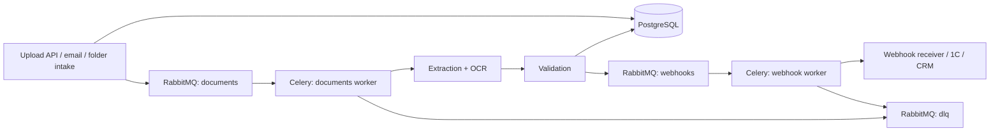

# Async Document Queue

[](https://github.com/Nikita-Kotlyar/async-document-queue/actions/workflows/ci.yml)
[](#testing)
[](https://www.python.org/)
[](LICENSE)

Asynchronous document ingestion pipeline: upload or email intake → RabbitMQ →
Celery workers → extraction, OCR and validation → PostgreSQL → signed webhooks.

## Problem

Supplier invoices and quality acts arrive as PDF, DOCX, XLSX, CSV and scanned
PNG files. Some files are duplicates, some are corrupt, and some contain
inconsistent totals, units or business keys. Manual processing loses documents
and makes it impossible to prove that a file was processed exactly once.

The service accepts each document, deduplicates it by SHA-256, extracts structured
fields, runs OCR when needed, validates the result, publishes a signed webhook and
retries transient failures. Documents that exhaust retries are moved to a
dead-letter queue for manual review.

## Architecture



| Component | Role | Host port |
|---|---|---|
| `api` | FastAPI ingestion and query API | `ADQ_API_PORT` (default `8081`) |
| `worker` | Celery workers for documents, OCR and webhooks | internal |
| `beat` | Periodic stale-job reaper | internal |
| `intake` | Async mailbox and folder watcher | internal |
| `webhook-sink` | Reference receiver for signed webhook events | `ADQ_WEBHOOK_PORT` (default `8090`) |
| `db` | PostgreSQL 16 | `ADQ_POSTGRES_PORT` (default `5433`) |
| `redis` | Distributed locks, idempotency, fault injection | `ADQ_REDIS_PORT` (default `6380`) |
| `rabbitmq` | Broker, queues and dead-letter exchange | `ADQ_RABBITMQ_PORT` (default `5672`) |
| `rabbitmq` management | Queue and exchange UI | `ADQ_RABBITMQ_MANAGEMENT_PORT` (default `15672`) |

## Tech stack

| Layer | Technology |
|---|---|
| API | FastAPI, Pydantic v2, OpenAPI |
| Async I/O | asyncio, `httpx.AsyncClient`, SQLAlchemy async |
| Queue | Celery, RabbitMQ, dead-letter exchange |
| Storage | PostgreSQL 16, Alembic |
| Locks and fault injection | Redis 7 |
| Documents | pypdf, PyMuPDF, python-docx, openpyxl, Pillow, Tesseract |
| Webhooks | HMAC-SHA256 signatures, retries, event ids |
| Infrastructure | Docker, Docker Compose, healthchecks |
| Quality | pytest, pytest-asyncio, pytest-timeout, coverage, ruff |

## Quick start

```bash
cp .env.example .env
# Fill in POSTGRES_PASSWORD, RABBITMQ_DEFAULT_PASS and ADQ_WEBHOOK_SECRET.
docker compose up -d --build
docker compose ps
```

The API is exposed on the host port configured by `ADQ_API_PORT` (default
`8081`). Swagger UI is available at `/docs`. RabbitMQ Management uses
`ADQ_RABBITMQ_MANAGEMENT_PORT` (default `15672`).

Create a document:

```bash
curl -X POST "http://<host>:${ADQ_API_PORT:-8081}/api/v1/documents" \
  -F "file=@examples/inbox/sample-batch-01/drop/invoice_sample_001.pdf"
```

Check status:

```bash
curl "http://<host>:${ADQ_API_PORT:-8081}/api/v1/documents"
curl "http://<host>:${ADQ_API_PORT:-8081}/api/v1/stats"
curl "http://<host>:${ADQ_API_PORT:-8081}/api/v1/dead-letter"
```

## Configuration

All settings use the `ADQ_` prefix and can be supplied through `.env` or the
environment. Required values have no production default.

| Variable | Purpose | Required | Default |
|---|---|---|---|
| `POSTGRES_PASSWORD` | PostgreSQL password | yes | — |
| `RABBITMQ_DEFAULT_PASS` | RabbitMQ password | yes | — |
| `ADQ_DATABASE_URL` | Async SQLAlchemy URL | yes | — |
| `ADQ_SYNC_DATABASE_URL` | Sync SQLAlchemy URL for Alembic/Celery | yes | — |
| `ADQ_BROKER_URL` | AMQP broker URL | yes | — |
| `ADQ_WEBHOOK_SECRET` | HMAC secret for webhook signatures | yes | — |
| `ADQ_REDIS_URL` | Redis URL | no | `redis://redis:6379/0` |
| `ADQ_API_KEY` | Optional API key for admin endpoints | no | empty |
| `ADQ_API_PORT` | Published API port | no | `8081` |
| `ADQ_POSTGRES_PORT` | Published PostgreSQL port | no | `5433` |
| `ADQ_REDIS_PORT` | Published Redis port | no | `6380` |
| `ADQ_RABBITMQ_PORT` | Published AMQP port | no | `5672` |
| `ADQ_RABBITMQ_MANAGEMENT_PORT` | Published management UI port | no | `15672` |
| `ADQ_WEBHOOK_PORT` | Published webhook-sink port | no | `8090` |
| `ADQ_MAX_UPLOAD_MB` | Maximum upload size | no | `25` |
| `ADQ_TASK_MAX_RETRIES` | Celery retry limit | no | `3` |
| `ADQ_WEBHOOK_MAX_ATTEMPTS` | Webhook delivery limit | no | `4` |
| `ADQ_ENABLE_FAULT_INJECTION` | Enables controlled OCR/webhook failures | no | `true` |

## API

| Method | Path | Purpose |
|---|---|---|
| `POST` | `/api/v1/documents` | Upload a document; `Idempotency-Key` supported |
| `GET` | `/api/v1/documents` | List with status, type, priority and pagination |
| `GET` | `/api/v1/documents/{id}` | Document, extraction, jobs, issues, deliveries |
| `POST` | `/api/v1/documents/{id}/reprocess` | Re-enqueue a document |
| `GET` | `/api/v1/dead-letter` | List dead-letter entries |
| `POST` | `/api/v1/dead-letter/{id}/retry` | Replay a dead-letter document or delivery |
| `GET` | `/api/v1/stats` | Aggregated status and delivery counts |
| `POST` | `/api/v1/webhooks/endpoints` | Register a webhook receiver |
| `GET` | `/api/v1/webhooks/deliveries` | Inspect delivery attempts |
| `POST` | `/api/v1/admin/faults` | Controlled fault injection |
| `GET` | `/health`, `/ready`, `/metrics` | Operational endpoints |

## Processing model

```text
queued → processing → validated | needs_review | failed | dead_letter
```

- `validated` — extraction and validation passed.
- `needs_review` — extraction succeeded but warnings were produced (OCR
  confidence, total mismatch, duplicate business key, unit conversion).
- `dead_letter` — processing failed permanently or retries were exhausted.

Idempotency uses SHA-256 content hashes, a PostgreSQL unique constraint and a
Redis `SET NX EX` lock. Re-uploading the same bytes returns the existing document
with `duplicate: true`; it does not enqueue another job.

## Testing

```bash
pytest -m "not integration"
ADQ_INTEGRATION=1 ADQ_API_URL="http://<host>:${ADQ_API_PORT:-8081}" pytest -m integration
```

Unit and API tests use SQLite; PostgreSQL, Redis and RabbitMQ are exercised by
the live integration suite. The coverage gate is 75%.

## CI

The GitHub Actions workflow contains two jobs:

- `test` — installs Python 3.13 and Tesseract, runs unit/API tests with coverage.
- `compose-smoke` — builds the Compose stack, waits for API health, seeds a
  webhook receiver and runs the integration suite.

No production secrets are stored in the repository. The Compose smoke job uses
CI-only placeholder values; `CI_WEBHOOK_SECRET` can override the webhook signing
secret if required.

## Design decisions

- **Redis** provides distributed locks and idempotency keys
  (`adq:lock:upload:*`) and controlled fault injection (`adq:fault:ocr`).
  Celery results are disabled (`task_ignore_result=True`); Redis is not used as a
  Celery result backend.
- **asyncio** is used by FastAPI endpoints, the intake watcher and async HTTP
  webhook delivery. Celery workers are synchronous; asyncio and Celery are not
  mixed inside a single task, apart from `asyncio.run()` at the async HTTP boundary.
- **SQLite** is limited to unit/API tests. PostgreSQL is the production store and
  is exercised by live integration runs.
- **`avg_processing_seconds`** measures enqueue-to-completion time, including
  queue wait. It is not an OCR throughput metric.
- **Dead-letter documents also emit `document.failed` webhooks**, so consumers
  learn about failures. `webhook_deliveries.delivered` therefore includes both
  successful and failed documents.
- **Authentication** is intentionally minimal: the API key is optional and empty
  by default; JWT/RBAC are not implemented. A production deployment should add
  ingress authentication and rate limiting.

## Project structure

```text
app/
  api/            # FastAPI routers
  services/       # extraction, OCR, validation, webhooks, faults
  tasks/          # Celery application and tasks
  workers/        # mailbox and folder intake
alembic/          # database migrations
examples/inbox/   # synthetic sample batch
scripts/          # sample-batch builder
tests/            # unit, API and integration tests
webhook_sink/     # reference webhook receiver
docs/             # architecture and operations notes
```

## Sample data

`examples/inbox/sample-batch-01/` contains only synthetic documents. Names,
identifiers, addresses and amounts are fictional placeholders such as
`ACME Sample LLC` and `INV-2099-0042`. The batch includes valid invoices, OCR
scans, duplicates, validation defects, an unsupported archive and a truncated
PDF. Regenerate it with:

```bash
python scripts/build_sample_batch.py
```

## License

MIT. See [LICENSE](LICENSE).
