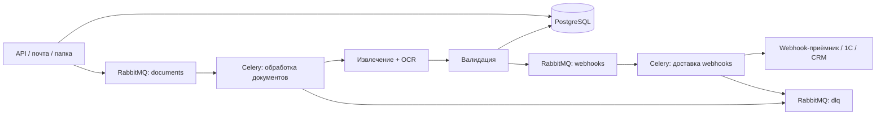

# Async Document Queue

[](https://github.com/Nikita-Kotlyar/async-document-queue/actions/workflows/ci.yml)
[](#тестирование)
[](https://www.python.org/)
[](LICENSE)

Асинхронный конвейер приёма документов: загрузка через API или почту → RabbitMQ →
Celery-воркеры → извлечение, OCR и валидация → PostgreSQL → подписанные webhooks.

## Проблема

Счета и акты качества приходят от поставщиков в форматах PDF, DOCX, XLSX, CSV и
PNG-сканов. Часть файлов дублируется, часть повреждена, в части документов
расходятся суммы, единицы измерения и бизнес-ключи. При ручной обработке
документы теряются, а доказать, что каждый файл обработан ровно один раз,
невозможно.

Сервис принимает документ, дедуплицирует его по SHA-256, извлекает структурированные поля,
при необходимости запускает OCR, валидирует результат, публикует подписанный
webhook и повторяет временные сбои. Документы, исчерпавшие попытки, попадают в
dead-letter очередь для ручного разбора.

## Архитектура



| Компонент | Роль | Порт на хосте |
|---|---|---|
| `api` | FastAPI: загрузка, запросы, статистика | `ADQ_API_PORT` (по умолчанию `8081`) |
| `worker` | Celery: документы, OCR, webhooks | внутренний |
| `beat` | Периодическая очистка зависших задач | внутренний |
| `intake` | Асинхронный watcher почты и папки | внутренний |
| `webhook-sink` | Эталонный приёмник подписанных событий | `ADQ_WEBHOOK_PORT` (по умолчанию `8090`) |
| `db` | PostgreSQL 16 | `ADQ_POSTGRES_PORT` (по умолчанию `5433`) |
| `redis` | Distributed locks, идемпотентность, fault injection | `ADQ_REDIS_PORT` (по умолчанию `6380`) |
| `rabbitmq` | Брокер, очереди и dead-letter exchange | `ADQ_RABBITMQ_PORT` (по умолчанию `5672`) |
| `rabbitmq` management | UI очередей и exchange | `ADQ_RABBITMQ_MANAGEMENT_PORT` (по умолчанию `15672`) |

## Стек

| Слой | Технологии |
|---|---|
| API | FastAPI, Pydantic v2, OpenAPI |
| Асинхронный ввод-вывод | asyncio, `httpx.AsyncClient`, SQLAlchemy async |
| Очереди | Celery, RabbitMQ, dead-letter exchange |
| Хранилище | PostgreSQL 16, Alembic |
| Блокировки и fault injection | Redis 7 |
| Документы | pypdf, PyMuPDF, python-docx, openpyxl, Pillow, Tesseract |
| Webhooks | HMAC-SHA256, повторы, стабильные event id |
| Инфраструктура | Docker, Docker Compose, healthchecks |
| Качество | pytest, pytest-asyncio, pytest-timeout, coverage, ruff |

## Быстрый старт

```bash
cp .env.example .env
# Заполни POSTGRES_PASSWORD, RABBITMQ_DEFAULT_PASS и ADQ_WEBHOOK_SECRET.
docker compose up -d --build
docker compose ps
```

API доступен на порту, заданном в `ADQ_API_PORT` (по умолчанию `8081`).
Swagger UI — по пути `/docs`. RabbitMQ Management использует
`ADQ_RABBITMQ_MANAGEMENT_PORT` (по умолчанию `15672`).

Загрузка документа:

```bash
curl -X POST "http://<host>:${ADQ_API_PORT:-8081}/api/v1/documents" \
  -F "file=@examples/inbox/sample-batch-01/drop/invoice_sample_001.pdf"
```

Проверка статуса:

```bash
curl "http://<host>:${ADQ_API_PORT:-8081}/api/v1/documents"
curl "http://<host>:${ADQ_API_PORT:-8081}/api/v1/stats"
curl "http://<host>:${ADQ_API_PORT:-8081}/api/v1/dead-letter"
```

## Конфигурация

Все настройки используют префикс `ADQ_` и задаются через `.env` или переменные
окружения. Обязательные значения не имеют production-дефолтов.

| Переменная | Назначение | Обязательна | По умолчанию |
|---|---|---|---|
| `POSTGRES_PASSWORD` | Пароль PostgreSQL | да | — |
| `RABBITMQ_DEFAULT_PASS` | Пароль RabbitMQ | да | — |
| `ADQ_DATABASE_URL` | Async URL для SQLAlchemy | да | — |
| `ADQ_SYNC_DATABASE_URL` | Sync URL для Alembic и Celery | да | — |
| `ADQ_BROKER_URL` | AMQP URL брокера | да | — |
| `ADQ_WEBHOOK_SECRET` | Секрет HMAC для webhook-подписи | да | — |
| `ADQ_REDIS_URL` | URL Redis | нет | `redis://redis:6379/0` |
| `ADQ_API_KEY` | Опциональный ключ для admin-эндпоинтов | нет | пусто |
| `ADQ_API_PORT` | Порт API на хосте | нет | `8081` |
| `ADQ_POSTGRES_PORT` | Порт PostgreSQL на хосте | нет | `5433` |
| `ADQ_REDIS_PORT` | Порт Redis на хосте | нет | `6380` |
| `ADQ_RABBITMQ_PORT` | Порт AMQP на хосте | нет | `5672` |
| `ADQ_RABBITMQ_MANAGEMENT_PORT` | Порт RabbitMQ UI | нет | `15672` |
| `ADQ_WEBHOOK_PORT` | Порт webhook-sink | нет | `8090` |
| `ADQ_MAX_UPLOAD_MB` | Максимальный размер файла | нет | `25` |
| `ADQ_TASK_MAX_RETRIES` | Лимит повторов Celery | нет | `3` |
| `ADQ_WEBHOOK_MAX_ATTEMPTS` | Лимит доставок webhook | нет | `4` |
| `ADQ_ENABLE_FAULT_INJECTION` | Управляемые сбои OCR/webhook | нет | `true` |

## API

| Метод | Путь | Назначение |
|---|---|---|
| `POST` | `/api/v1/documents` | Загрузка документа; поддерживается `Idempotency-Key` |
| `GET` | `/api/v1/documents` | Список с фильтрами, статусами и пагинацией |
| `GET` | `/api/v1/documents/{id}` | Документ, извлечение, задачи, проблемы, доставки |
| `POST` | `/api/v1/documents/{id}/reprocess` | Повторная постановка в очередь |
| `GET` | `/api/v1/dead-letter` | Список dead-letter записей |
| `POST` | `/api/v1/dead-letter/{id}/retry` | Повторный запуск документа или доставки |
| `GET` | `/api/v1/stats` | Агрегированная статистика |
| `POST` | `/api/v1/webhooks/endpoints` | Регистрация получателя webhook |
| `GET` | `/api/v1/webhooks/deliveries` | История попыток доставки |
| `POST` | `/api/v1/admin/faults` | Управляемая инъекция сбоя |
| `GET` | `/health`, `/ready`, `/metrics` | Эксплуатационные эндпоинты |

## Модель обработки

```text
queued → processing → validated | needs_review | failed | dead_letter
```

- `validated` — извлечение и валидация прошли без замечаний.
- `needs_review` — документ распознан, но есть предупреждения: низкая
  уверенность OCR, расхождение суммы, дубль бизнес-ключа, нестандартная единица.
- `dead_letter` — постоянная ошибка или исчерпаны все повторы.

Идемпотентность обеспечивается SHA-256 содержимого, уникальным индексом в
PostgreSQL и блокировкой Redis `SET NX EX`. Повторная загрузка тех же байтов
возвращает существующий документ с `duplicate: true` и не создаёт новую задачу.

## Тестирование

```bash
pytest -m "not integration"
ADQ_INTEGRATION=1 ADQ_API_URL="http://<host>:${ADQ_API_PORT:-8081}" pytest -m integration
```

Unit/API-тесты используют SQLite; PostgreSQL, Redis и RabbitMQ проверяются
live-интеграцией. Порог coverage — 75%.

## CI

GitHub Actions содержит два job:

- `test` — устанавливает Python 3.13 и Tesseract, запускает unit/API-тесты с
  coverage.
- `compose-smoke` — собирает Compose-стек, ждёт health API, регистрирует
  webhook-приёмник и запускает интеграционные тесты.

Production-секреты в репозитории не хранятся. В CI используются только
тестовые плейсхолдеры; при необходимости секрет подписи webhook можно
переопределить через `CI_WEBHOOK_SECRET`.

## Проектные решения

- **Redis** используется для distributed locks и идемпотентности
  (`adq:lock:upload:*`) и управляемой инъекции сбоев (`adq:fault:ocr`).
  Результаты Celery отключены (`task_ignore_result=True`); Redis не используется
  как result backend.
- **asyncio** применяется в FastAPI, intake-сервисе и async HTTP для webhook.
  Celery-воркеры синхронные; asyncio и Celery не смешиваются внутри одной задачи,
  кроме `asyncio.run()` на границе async HTTP.
- **SQLite** используется только в unit/API-тестах. PostgreSQL — production-
  хранилище и проверяется live-интеграцией.
- **`avg_processing_seconds`** — время от постановки в очередь до завершения,
  включая ожидание. Это не метрика производительности OCR.
- **Dead-letter документы тоже отправляют webhook `document.failed`**, чтобы
  потребители узнавали о неудаче. Поэтому `webhook_deliveries.delivered`
  включает и успешные, и проваленные документы.
- **Аутентификация** намеренно минимальна: API-ключ опционален и по умолчанию
  пуст; JWT/RBAC не реализованы. Для production нужен ingress, аутентификация
  и ограничение скорости.

## Структура проекта

```text
app/
  api/            # маршруты FastAPI
  services/       # извлечение, OCR, валидация, webhooks, faults
  tasks/          # Celery-приложение и задачи
  workers/        # intake почты и папки
alembic/          # миграции БД
examples/inbox/   # синтетическая примерная пачка
scripts/          # генератор примерной пачки
tests/            # unit, API и integration тесты
webhook_sink/     # эталонный приёмник webhook
docs/             # архитектура и runbook
```

## Пример данных

`examples/inbox/sample-batch-01/` содержит только синтетические документы.
Имена, идентификаторы, адреса и суммы вымышлены: `ACME Sample LLC`,
`INV-2099-0042`, `QA-2099-0001`, `sender@example.com`. В пачке есть валидные
счета, OCR-сканы, дубли, документы с ошибками валидации, неподдерживаемый архив
и обрезанный PDF. Пересобрать пачку:

```bash
python scripts/build_sample_batch.py
```

## Документация

- [Архитектура](docs/architecture.md)
- [Runbook](docs/runbook.md)
- [Contributing](CONTRIBUTING.md)

## Лицензия

MIT. См. [LICENSE](LICENSE).
